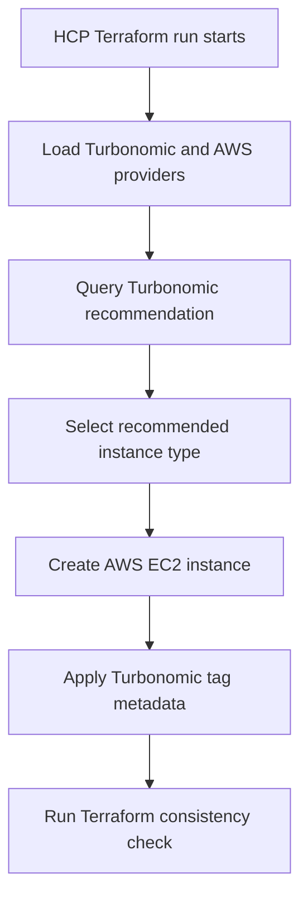

# HCP Terraform + Turbonomic Demo

This repository contains a simple Terraform demo that shows how to use the IBM Turbonomic provider with HCP Terraform to provision an AWS EC2 instance using a Turbonomic recommendation.

## What this demo does

During a Terraform run, the configuration:

1. Connects to Turbonomic
2. Looks up a recommendation for a virtual machine named `exampleVirtualMachine`
3. Uses the recommended AWS instance type for a new EC2 instance
4. Applies Turbonomic tag metadata to the provisioned resource
5. Validates that the deployed instance type matches the latest recommendation

At a high level, this demonstrates how HCP Terraform can consume Turbonomic guidance during infrastructure provisioning.

## Two demo paths

The configuration deploys two EC2 instances so both ways of acting on Turbonomic recommendations can be shown side by side:

| | Automatic path | Governed (GitHub issue) path |
|---|---|---|
| Resource | `aws_instance.terraform-demo-ec2` | `aws_instance.governed-demo-ec2` |
| Name in Turbonomic | `exampleVirtualMachine` | `exampleGovernedVM` |
| `instance_type` | From the Turbonomic data source on every plan | Hard-coded, changed only by a reviewed PR |
| `DemoPath` tag | `auto-provider` | `github-issue` |
| Turbonomic policy | None needed | Cloud Scale All, Recommend only, GitHub Issue workflow on generation |

- **Automatic path:** Turbonomic recommends a new size, and the next HCP Terraform plan picks it up and resizes the instance with no code change.
- **Governed path:** Turbonomic generates a scale action, a webhook workflow opens a GitHub issue in this repository, and the HCP Terraform plan shows a `check` warning. Someone opens a PR that changes `instance_type` and closes the issue (`Fixes #N`). Merging the PR applies the change.

The governed instance starts at `t3.medium` so that an idle instance gets a scale-down recommendation.

See [GitHub issue governance setup](#github-issue-governance-setup) for the Turbonomic and GitHub configuration.

## Repository contents

This demo is intentionally minimal and centers on a single Terraform configuration file:

- `main.tf`

## How it works

The Terraform configuration uses:

- The `IBM/turbonomic` provider
- The `hashicorp/aws` provider
- A `turbonomic_cloud_entity_recommendation` data source to retrieve the recommended instance type
- An `aws_instance` resource to provision an EC2 instance
- A Terraform `check` block to ensure the provisioned instance remains aligned with the recommendation

## Architecture flow



## Prerequisites

Before you begin, make sure you have:

- An HCP Terraform account
- An HCP Terraform workspace for this demo
- An AWS account with permissions to create EC2 instances
- AWS credentials configured for use in HCP Terraform
- Access to a Turbonomic instance
- A Turbonomic username and password
- A target entity in Turbonomic named `exampleVirtualMachine`, or you are prepared to update the Terraform configuration to use a different entity name

## Demo assumptions

This configuration currently assumes:

- AWS region: `us-east-1`
- The EC2 AMI ID is valid in that region
- The Turbonomic entity to query is named `exampleVirtualMachine`
- The desired fallback/default size is `t3.nano`

If your environment differs, update the Terraform configuration before running the demo.

## Required Terraform variables

The workspace expects the following Terraform variables:

- `turbo_hostname`
- `turbo_username`
- `turbo_password`

Recommended configuration in HCP Terraform:

- Set `turbo_hostname` as a normal Terraform variable
- Set `turbo_username` as a normal Terraform variable
- Set `turbo_password` as a **sensitive** Terraform variable

> Note: The intended Turbonomic provider configuration should use `hostname = var.turbo_hostname` without quotes.

## AWS credentials in HCP Terraform

In addition to Terraform variables, the workspace must also be able to authenticate to AWS.

A common way to do that in HCP Terraform is to define these environment variables in the workspace:

- `AWS_ACCESS_KEY_ID`
- `AWS_SECRET_ACCESS_KEY`

Depending on your environment, you may also need:

- `AWS_SESSION_TOKEN`

If you are using dynamic credentials or another AWS authentication pattern, configure that instead.

## Setup steps

### 1. Clone the repository

```bash
git clone <your-repo-url>
cd <your-repo-directory>
```

### 2. Create an HCP Terraform workspace

In HCP Terraform:

1. Create a new workspace
2. Connect it to this repository
3. Set the working directory if needed
4. Confirm Terraform can discover `main.tf`

### 3. Add Terraform variables

In the workspace, add these Terraform variables:

| Name | Category | Sensitive |
|------|----------|-----------|
| `turbo_hostname` | Terraform variable | No |
| `turbo_username` | Terraform variable | No |
| `turbo_password` | Terraform variable | Yes |

Example values:

- `turbo_hostname`: your Turbonomic hostname or URL
- `turbo_username`: your Turbonomic username
- `turbo_password`: your Turbonomic password

### 4. Add AWS credentials

In the workspace, add the required AWS environment variables so Terraform can create the EC2 instance.

At minimum, add:

- `AWS_ACCESS_KEY_ID`
- `AWS_SECRET_ACCESS_KEY`

Mark secrets as sensitive.

### 5. Review the Terraform configuration

Before your first run, verify these values match your environment:

- Turbonomic hostname usage is correct
- AWS region is correct
- The AMI ID is valid for the selected region
- The Turbonomic entity name exists
- The default size is appropriate

The configuration currently queries this entity:

```hcl
entity_name  = "exampleVirtualMachine"
entity_type  = "VirtualMachine"
default_size = "t3.nano"
```

If your Turbonomic environment uses a different entity name, update `entity_name` before running the demo.

### 6. Queue a plan in HCP Terraform

Start a new plan in the workspace.

During the plan, Terraform will:

- Authenticate to Turbonomic
- Retrieve the recommended instance type
- Build the AWS EC2 resource using that recommendation

Review the plan output and confirm the selected `instance_type` looks correct.

### 7. Apply the run

Apply the run in HCP Terraform.

This creates an EC2 instance in AWS using the recommended instance type returned by Turbonomic.

### 8. Validate the result

After apply completes, verify:

- The EC2 instance exists in AWS
- The instance type matches the recommendation
- The instance is tagged correctly
- The Terraform check passes successfully

## GitHub issue governance setup

Based on the IBM Community blog [Using GitHub Issues to bring governance to Turbonomic resource optimizations for Infrastructure described as Code](https://community.ibm.com/community/user/blogs/anoop-john/2026/07/13/using-github-issues-to-govern-turbonomic-iac).

### 1. Prepare the GitHub repository

1. Make sure Issues is enabled under **Settings > General > Features**.
2. Create the labels `turbonomic`, `automated` and `action-review`.
3. Create a fine-grained personal access token limited to this repository, with **Issues: Read and write**.
4. Test it:

   ```bash
   curl -H "Authorization: Bearer <TOKEN>" https://api.github.com/repos/StevenJohnWeaver/TF-Turbonomic
   ```

### 2. Create the webhook workflow in Turbonomic

**Settings > Workflows > Create Workflow > Webhook**:

- **Address:** `https://api.github.com/repos/StevenJohnWeaver/TF-Turbonomic/issues`
- **HTTP method:** `POST`
- **Authentication:** None (the token goes in a header)
- **Headers:**
  - `Authorization`: `Bearer <TOKEN>`
  - `Accept`: `application/vnd.github+json`
- **Request body:** JSON, using this template (replace `<YOUR-TURBO-HOST>`):

```json
{
  "title": "Turbonomic ${action.actionType}: ${action.target.displayName}",
  "body": "**Action Details**\n\n**Action Type:** ${action.actionType}\n**Target:** ${action.target.displayName}\n**Target UUID:** ${action.target.uuid}\n**Action UUID:** ${action.uuid}\n**Created At:** ${action.createTime}\n\n**Description**\n\n${action.details}\n\n---\n\n**Review Checklist**\n\n- [ ] Review the action details\n- [ ] Assess impact on dependent services\n- [ ] Approve or reject with comments\n- [ ] Update Terraform configuration if approved\n- [ ] Verify in Turbonomic UI: [View Action](https://<YOUR-TURBO-HOST>/app/#/view/main/action/${action.uuid})\n\n---\n\n**Automated Issue** | Created by Turbonomic Workflow | **Do not edit title or UUID**",
  "labels": ["turbonomic", "automated", "action-review"],
  "assignees": []
}
```

Do not use `##` Markdown headings in the template. Turbonomic renders templates with Apache Velocity, where `##` starts a comment, so the rest of the line is dropped and the JSON breaks.

To test, open any pending action in Turbonomic and copy the number at the end of its URL (`.../view/main/action/<uuid>`) into **Action UUID**. Run **Verify template**, then **Test webhook**.

### 3. Create the group

**Settings > Groups > New Group > Virtual Machine**, dynamic, with the filter **Tag** `DemoPath` = `github-issue`. The tag appears in the filter only after the governed instance is deployed and Turbonomic has rediscovered the AWS account.

Check that the preview shows only `exampleGovernedVM`. A group scoped only by account matches every VM in the account, and each of them would create issues.

### 4. Create the automation policy

**Settings > Policies > New Automation Policy > Virtual Machine**:

- **Scope:** the group from step 3
- **Action type:** Cloud Scale All
- **Action generation:** Recommend only
- **On generation:** Non-critical workflow, `GitHub Issue - TF-Turbonomic`
- **Execution schedule:** none (Recommend only actions are never executed)

### Terraform target (optional)

The blog also adds a Turbonomic **Terraform** (IaC) target connected to HCP Terraform, which adds code context to actions and enables the **IaC** group filters. It was not available on the Turbonomic SaaS trial used for this demo (only the **Terraform Provider** target was listed). The workflow works without it, using the tag-based group above.

## Expected behavior

For the automatic path, the EC2 instance type is not hard-coded. Instead, it is derived from the Turbonomic recommendation data source.

Each instance has a Terraform `check` block that compares the deployed instance type with the latest Turbonomic recommendation. A failed check is reported as a **warning** in the plan or apply output and does not stop the run:

```text
Must use the latest recommended instance type, <recommended_type>
Turbonomic recommends <recommended_type> for exampleGovernedVM; resize via a PR that closes the open Turbonomic issue
```

For the governed instance the warning is expected while a recommendation is pending. It goes away once a PR updates `instance_type`.

## Troubleshooting

### Turbonomic authentication fails

Check:

- `turbo_hostname`
- `turbo_username`
- `turbo_password`

Also confirm the Turbonomic instance is reachable from the Terraform runtime environment.

### No recommendation is returned

Check that:

- The entity exists in Turbonomic
- The entity name matches exactly
- The entity type is correct
- Turbonomic can generate a recommendation for that entity

### AWS authentication fails

Check the workspace environment variables and confirm the credentials have permission to create EC2 instances.

### AMI is invalid

The configured AMI must exist in `us-east-1`. If it does not, replace it with a valid AMI for your target region.

### Terraform check fails

If the consistency check fails, it usually means the instance type being applied does not match the recommendation returned by Turbonomic.

Re-run the plan and confirm the recommendation is stable and being used consistently.

For `exampleGovernedVM`, this warning is expected while a Turbonomic recommendation is waiting for a PR.

### AWS target fails with "web identity token could not be validated"

On Turbonomic SaaS, the IAM role option needs IBM's OIDC identity provider registered in your AWS account (see IBM's [Turbonomic SaaS IAM Role Setup](https://www.ibm.com/support/pages/turbonomic-saas-iam-role-setup)). For a trial, an IAM user with the AWS managed `ReadOnlyAccess` policy and an access key is quicker.

### Webhook test fails

- **HTML "Whoa there!" page (400):** the HTTP request is malformed, usually a stray space in a header name (for example `Authorization `) or in the address.
- **401 Bad credentials:** the `Authorization` value is wrong. Delete the header and add it again rather than editing it, typing `Bearer ` by hand and then pasting the token.
- **400 Problems parsing JSON:** the rendered template is not valid JSON. Check for `##` in the template (see the setup section).
- **422 Validation failed:** usually one of the labels does not exist in the repository.

### No GitHub issue is created

- Check the group preview contains `exampleGovernedVM`.
- Workflows run when an action is generated. An action that already existed before the policy was saved may not trigger it until the next analysis cycle.

## Security notes

- Store `turbo_password` as a sensitive Terraform variable in HCP Terraform
- Store AWS secrets as sensitive environment variables
- Review the use of `skipverify = true` in the Turbonomic provider configuration before using this outside a lab or demo environment

Disabling TLS verification may be acceptable for a temporary demo, but it should not be used in production without understanding the security implications.

## Cleanup

To remove the demo resources:

1. Open the HCP Terraform workspace
2. Queue a destroy plan
3. Review the destroy output
4. Apply the destroy run

This will remove both EC2 instances created by the demo. Afterwards, also delete the GitHub token, the IAM user or access key used by Turbonomic, and close any open Turbonomic issues.

## Summary

This demo shows how to:

- Use HCP Terraform as the execution platform
- Query Turbonomic for infrastructure guidance
- Provision AWS infrastructure based on that guidance
- Validate that the deployed resource remains aligned with the recommendation

It is a simple example, but it provides a useful pattern for policy-aware or optimization-aware infrastructure provisioning.