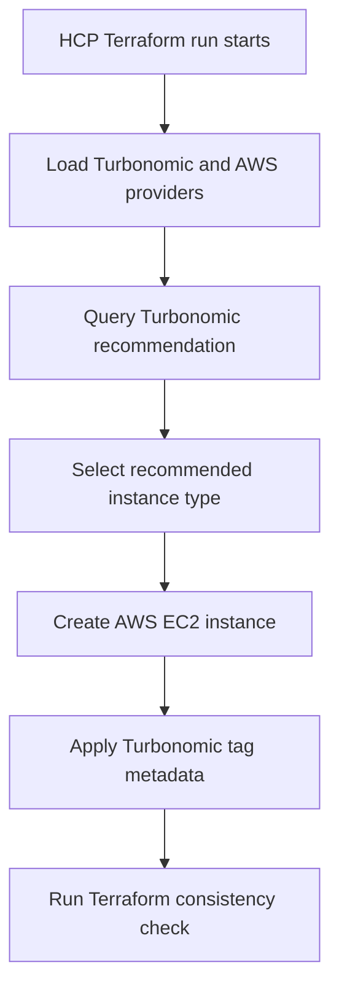

# HCP Terraform + Turbonomic Demo

This repository contains a simple Terraform demo that shows how to use the IBM Turbonomic provider with HCP Terraform to provision an AWS EC2 instance using a Turbonomic recommendation.

## What this demo does

During a Terraform run, the configuration:

1. Connects to Turbonomic
2. Looks up a recommendation for a virtual machine named `exampleVirtualMachine`
3. Uses the recommended AWS instance type for a new EC2 instance
4. Applies Turbonomic tag metadata to the provisioned resource
5. Validates that the deployed instance type matches the latest recommendation

At a high level, this demonstrates how HCP Terraform can consume Turbonomic guidance during infrastructure provisioning.

## Repository contents

This demo is intentionally minimal and centers on a single Terraform configuration file:

- `main.tf`

## How it works

The Terraform configuration uses:

- The `IBM/turbonomic` provider
- The `hashicorp/aws` provider
- A `turbonomic_cloud_entity_recommendation` data source to retrieve the recommended instance type
- An `aws_instance` resource to provision an EC2 instance
- A Terraform `check` block to ensure the provisioned instance remains aligned with the recommendation

## Architecture flow



## Prerequisites

Before you begin, make sure you have:

- An HCP Terraform account
- An HCP Terraform workspace for this demo
- An AWS account with permissions to create EC2 instances
- AWS credentials configured for use in HCP Terraform
- Access to a Turbonomic instance
- A Turbonomic username and password
- A target entity in Turbonomic named `exampleVirtualMachine`, or you are prepared to update the Terraform configuration to use a different entity name

## Demo assumptions

This configuration currently assumes:

- AWS region: `us-east-1`
- The EC2 AMI ID is valid in that region
- The Turbonomic entity to query is named `exampleVirtualMachine`
- The desired fallback/default size is `t3.nano`

If your environment differs, update the Terraform configuration before running the demo.

## Required Terraform variables

The workspace expects the following Terraform variables:

- `turbo_hostname`
- `turbo_username`
- `turbo_password`

Recommended configuration in HCP Terraform:

- Set `turbo_hostname` as a normal Terraform variable
- Set `turbo_username` as a normal Terraform variable
- Set `turbo_password` as a **sensitive** Terraform variable

> Note: The intended Turbonomic provider configuration should use `hostname = var.turbo_hostname` without quotes.

## AWS credentials in HCP Terraform

In addition to Terraform variables, the workspace must also be able to authenticate to AWS.

A common way to do that in HCP Terraform is to define these environment variables in the workspace:

- `AWS_ACCESS_KEY_ID`
- `AWS_SECRET_ACCESS_KEY`

Depending on your environment, you may also need:

- `AWS_SESSION_TOKEN`

If you are using dynamic credentials or another AWS authentication pattern, configure that instead.

## Setup steps

### 1. Clone the repository

```bash
git clone <your-repo-url>
cd <your-repo-directory>
```

### 2. Create an HCP Terraform workspace

In HCP Terraform:

1. Create a new workspace
2. Connect it to this repository
3. Set the working directory if needed
4. Confirm Terraform can discover `main.tf`

### 3. Add Terraform variables

In the workspace, add these Terraform variables:

| Name | Category | Sensitive |
|------|----------|-----------|
| `turbo_hostname` | Terraform variable | No |
| `turbo_username` | Terraform variable | No |
| `turbo_password` | Terraform variable | Yes |

Example values:

- `turbo_hostname`: your Turbonomic hostname or URL
- `turbo_username`: your Turbonomic username
- `turbo_password`: your Turbonomic password

### 4. Add AWS credentials

In the workspace, add the required AWS environment variables so Terraform can create the EC2 instance.

At minimum, add:

- `AWS_ACCESS_KEY_ID`
- `AWS_SECRET_ACCESS_KEY`

Mark secrets as sensitive.

### 5. Review the Terraform configuration

Before your first run, verify these values match your environment:

- Turbonomic hostname usage is correct
- AWS region is correct
- The AMI ID is valid for the selected region
- The Turbonomic entity name exists
- The default size is appropriate

The configuration currently queries this entity:

```hcl
entity_name  = "exampleVirtualMachine"
entity_type  = "VirtualMachine"
default_size = "t3.nano"
```

If your Turbonomic environment uses a different entity name, update `entity_name` before running the demo.

### 6. Queue a plan in HCP Terraform

Start a new plan in the workspace.

During the plan, Terraform will:

- Authenticate to Turbonomic
- Retrieve the recommended instance type
- Build the AWS EC2 resource using that recommendation

Review the plan output and confirm the selected `instance_type` looks correct.

### 7. Apply the run

Apply the run in HCP Terraform.

This creates an EC2 instance in AWS using the recommended instance type returned by Turbonomic.

### 8. Validate the result

After apply completes, verify:

- The EC2 instance exists in AWS
- The instance type matches the recommendation
- The instance is tagged correctly
- The Terraform check passes successfully

## Expected behavior

The key behavior in this demo is that the EC2 instance type is not hard-coded. Instead, it is derived from the Turbonomic recommendation data source.

The configuration also includes a Terraform `check` block that ensures the provisioned instance type remains consistent with the recommended value. If there is a mismatch, the run will fail with a message similar to:

```text
Must use the latest recommended instance type, <recommended_type>
```

## Troubleshooting

### Turbonomic authentication fails

Check:

- `turbo_hostname`
- `turbo_username`
- `turbo_password`

Also confirm the Turbonomic instance is reachable from the Terraform runtime environment.

### No recommendation is returned

Check that:

- The entity exists in Turbonomic
- The entity name matches exactly
- The entity type is correct
- Turbonomic can generate a recommendation for that entity

### AWS authentication fails

Check the workspace environment variables and confirm the credentials have permission to create EC2 instances.

### AMI is invalid

The configured AMI must exist in `us-east-1`. If it does not, replace it with a valid AMI for your target region.

### Terraform check fails

If the consistency check fails, it usually means the instance type being applied does not match the recommendation returned by Turbonomic.

Re-run the plan and confirm the recommendation is stable and being used consistently.

## Security notes

- Store `turbo_password` as a sensitive Terraform variable in HCP Terraform
- Store AWS secrets as sensitive environment variables
- Review the use of `skipverify = true` in the Turbonomic provider configuration before using this outside a lab or demo environment

Disabling TLS verification may be acceptable for a temporary demo, but it should not be used in production without understanding the security implications.

## Cleanup

To remove the demo resources:

1. Open the HCP Terraform workspace
2. Queue a destroy plan
3. Review the destroy output
4. Apply the destroy run

This will remove the EC2 instance created by the demo.

## Summary

This demo shows how to:

- Use HCP Terraform as the execution platform
- Query Turbonomic for infrastructure guidance
- Provision AWS infrastructure based on that guidance
- Validate that the deployed resource remains aligned with the recommendation

It is a simple example, but it provides a useful pattern for policy-aware or optimization-aware infrastructure provisioning.