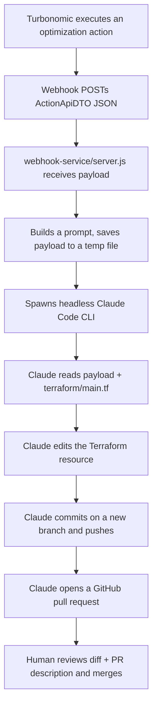

# AI-driven Terraform updates from Turbonomic actions

This demo follows the pattern described in IBM's tutorial ["Automate Terraform
updates from Turbonomic actions with AI"](https://developer.ibm.com/tutorials/automating-terraform-updates-from-turbonomic-actions-with-ai/):
when Turbonomic recommends and executes an optimization action (for example,
resizing a VM), the running infrastructure changes immediately — but the
Terraform code that provisioned it does not. Left alone, the next `terraform
apply` can silently undo the optimization. This demo closes that gap by
turning the Turbonomic action into an AI-authored Terraform code change and a
GitHub pull request for a human to review.

The original tutorial uses a custom Node.js webhook service that hands the
action off to **IBM Bob Shell** as the AI coding agent. This demo keeps the
same shape but substitutes the **headless Claude Code CLI** as the agent,
since that's what's already available in this environment.

## Architecture



This demo is wired for **simulation**: instead of a live Turbonomic instance
calling the webhook, you POST a sample action payload to the service
yourself. Everything downstream (Claude reading the payload, editing
Terraform, opening the PR) runs exactly as it would from a real webhook call.

## Repository contents

- `terraform/main.tf` — the "before" state: an `aws_instance` with a
  hardcoded `instance_type`. This is the file Claude edits.
- `webhook-service/` — the Express app that receives the webhook payload and
  invokes Claude Code.
- `sample-payloads/scale-action.json` — a representative Turbonomic
  `ActionApiDTO` payload for a cost-saving resize action
  (`t3.small` → `t3.micro`). Field names follow Turbonomic's documented
  shape, but if you later connect a real Turbonomic instance, capture one
  real webhook payload and swap it in — exact fields vary by version.
- `simulate.sh` — posts the sample payload to the running webhook service.

## Prerequisites

- Node.js (for the webhook service).
- The `claude` CLI installed and already authenticated in this environment.
- `git` configured with push access to this repository (this environment
  already has it for `stevenjohnweaver/tf-turbonomic`).
- The GitHub CLI (`gh`) or an MCP/GitHub token available so Claude Code can
  open a pull request. If you're running this inside the same Claude Code
  session/container that has GitHub access configured, this is already true.

## Setup

1. Install dependencies:
   ```bash
   cd ai-pr-demo/webhook-service
   npm install
   ```
2. Start the service:
   ```bash
   npm start
   ```
   By default it operates on the repo root two directories up
   (`REPO_ROOT` env var — override it if your clone lives elsewhere) and
   listens on port 4000 (`PORT` env var).

## Run the demo (simulated)

With the service running, from another terminal:

```bash
cd ai-pr-demo
bash simulate.sh
```

This POSTs `sample-payloads/scale-action.json` to the webhook. Watch the
`webhook-service` logs: you'll see the raw payload logged, then Claude Code
start up, read the payload, edit `terraform/main.tf`, and push a branch and
open a pull request. Review the PR's diff and description before merging —
nothing merges automatically.

## Connecting a real Turbonomic instance (optional)

To drive this from live Turbonomic actions instead of the sample payload,
configure Turbonomic exactly as the source tutorial describes:

1. **Settings → Workflows → Create Workflow** → connection type **Webhook**.
   - Address: the public URL of wherever you deploy `webhook-service`
     (it must be reachable from your Turbonomic instance — this demo's
     container is not internet-facing, so you'll need to deploy the service
     to a reachable host, e.g. a small VM or a tunnel for a live demo).
   - HTTP Method: `POST`, Content-Type: `application/json`.
   - Payload template: `converter.toJson($action)` to forward the full
     action object.
2. **Settings → Groups → New Group** (type Virtual Machine, Static) —
   scope it to the VM(s) you want Turbonomic managing for this demo.
3. **Settings → Policies → Automation → New Automation Policy** — scope to
   that group, Action Type = the scale/resize actions you want to trigger
   on, Action Generation = Manual, and under **On Execution → Critical
   Workflow** select the webhook you created in step 1.
4. Trigger a real action in the Turbonomic UI and watch the webhook service
   logs the same way as the simulated run.

## Security notes

- `--permission-mode bypassPermissions` lets Claude Code edit files, commit,
  push, and open PRs with **no per-action confirmation**. That's necessary
  for a webhook-driven, unattended flow, but it means anything that can POST
  to this service can cause Claude to act on this repo. Don't expose the
  service to the open internet without authentication — set `WEBHOOK_SECRET`
  and require Turbonomic to send it as `x-webhook-secret` (via a custom
  header or Basic Authentication on the webhook workflow), and prefer
  running this against a dedicated demo repo/branch rather than anything
  production-sensitive.
- Treat the webhook payload as untrusted input — this is why the prompt
  tells Claude to touch only the relevant Terraform file and to stop and
  explain itself rather than guess if it can't confidently map the action to
  a resource.
- Nothing merges automatically. The PR is the review/approval gate.

## Cleanup

- Close/delete any demo pull requests and branches (`turbonomic-action-*`)
  created during testing.
- If a PR was merged, revert `terraform/main.tf` to its original
  `instance_type` or re-run the flow with a payload that reverses the
  change.
